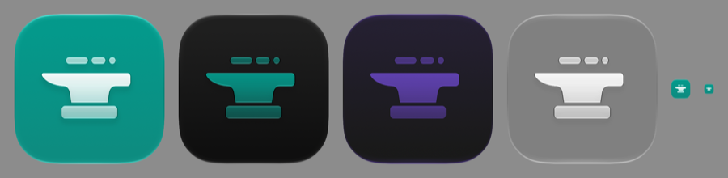
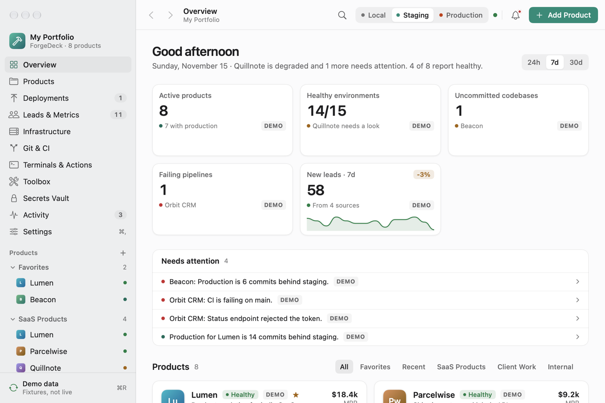

<p align="center"></p>

<h1 align="center">ForgeDeck</h1>

<p align="center">A native macOS control room for everything you build: where the code is, what is deployed, what is healthy, and one click into a terminal, editor, agent, or simulator.</p>

<p align="center"><a href="https://rmclain.github.io/forgedeck/">Website</a> · <a href="https://github.com/rmclain/forgedeck/releases/latest">Download</a> · <a href="docs/USER_MANUAL.md">Manual</a></p>



ForgeDeck is a SwiftUI app for people who run several products at once: SaaS apps, mobile apps, WordPress plugins, client sites, side projects. It keeps them in one sidebar and tells you, with evidence, what is going on with each one.

Everything stays on your Mac. There is no account, no server, and no telemetry. Secrets live in the macOS Keychain.

## What it does

- **Products, grouped your way.** Add a folder, a GitHub repository, an SSH host, or just a name. Rename products and groups, and drag products between groups.
- **An evidence chain for every product.** Local → GitHub → Staging → Production, each marked Verified, Reported, Stale, or Unknown. Production is never guessed from a green build or a `main` branch.
- **One click to work.** Open the checkout in a built-in terminal, your editor (Cursor, VS Code, Zed, Xcode, each in its own window), or an AI coding agent (Claude Code, Codex, Gemini, OpenCode, and others).
- **Play.** Launch what a product builds: run a mobile app on the simulator, start a desktop app, start a dev server and open the page, or open a local WordPress site's admin.
- **Context for agents.** Link related repositories and ForgeDeck writes a compact repo map an agent reads before it starts, so it spends fewer tokens getting oriented.
- **CI failures, ready to fix.** Fetch the failing GitHub Actions log, trimmed to the error, with a fix prompt you can hand to an agent.
- **AI usage at a glance.** A side panel reads Claude Code, Codex, and OpenCode's local logs and shows tokens used and limits left. Nothing is uploaded.
- **Scoped secrets.** Variables per product and environment, stored in the Keychain, injected only into the commands you allow. Production secrets ask for Touch ID.
- **Recipes and a toolbox.** Detected commands (tests, dev servers, Docker, simulators) start as suggestions and run only after you approve them. A toolbox finds repomix, ast-grep, ripgrep, gitleaks, and other tools that save tokens or check repositories.
- **A command line tool.** The app binary is also `forgedeck`: `forgedeck list`, `forgedeck status <product>`, `forgedeck exec`, `forgedeck context`.

## Install

1. Download `ForgeDeck-<version>.zip` from the [latest release](https://github.com/rmclain/forgedeck/releases/latest) and unzip it.
2. Drag **ForgeDeck.app** into **Applications**.
3. Open it. The app is signed but not notarized, so the first time macOS says it cannot check it. Click **Done**, open **System Settings › Privacy & Security**, and click **Open Anyway**. You only do this once.

Requires macOS 26 or later, on Apple silicon or Intel.

### Updates

ForgeDeck checks this repository's latest release once a day (you can turn that off in Settings › Diagnostics › About) and shows an **Update** button when there is a new version. **ForgeDeck › Check for Updates…** checks right away. An update is installed only if its code signature is valid and comes from the same developer as the copy you have. The old app goes to the Trash; your data is not touched.

## Build from source

```sh
./build.sh --open          # build, sign, install ~/Applications/ForgeDeck.app, open it
./build.sh --link-cli      # link ~/.local/bin/forgedeck to the app binary
scripts/test.sh            # kit tests, acceptance walkthroughs, build, in-app self-test, lint
tools/snap.sh              # light and dark screenshots of every page with demo data
scripts/release.sh         # universal zip in dist/, published as a GitHub release
```

Needs Xcode command line tools with Swift 6.2 or later, and `git`. `node` is needed only for the acceptance walkthroughs.

Your data is in `~/Library/Application Support/ForgeDeck` (`portfolio.json`, `cache.json`, `audit.jsonl`). Set `FORGEDECK_HOME` to use another folder.

## Privacy and security

- No account, no analytics, no server. The only network requests are the ones you set up (GitHub, your health checks, your metrics endpoints) and the daily update check, which asks GitHub for the latest release and sends nothing about you.
- Secret values are only in the Keychain. They are never written to ForgeDeck's files, logs, exports, launch scripts, or command arguments.
- External systems are read-only by default. Anything that writes to a remote system or touches production asks first, with the exact target, and needs a press and hold.
- SSH runs only a fixed list of read-only commands, with strict host key checking.

The full model is in [docs/SECURITY_MODEL.md](docs/SECURITY_MODEL.md).

## Documentation

| Document | Covers |
| --- | --- |
| [USER_MANUAL](docs/USER_MANUAL.md) | Using the app and the CLI |
| [ARCHITECTURE](docs/ARCHITECTURE.md) | Targets, data flow, storage, connectors |
| [SECURITY_MODEL](docs/SECURITY_MODEL.md) | Trust boundaries, Keychain, known limits |
| [INTEGRATIONS](docs/INTEGRATIONS.md) | Each connector and the companion contract |
| [AGENT_CONTEXT](docs/AGENT_CONTEXT.md) | Repo maps and linked context for agents |
| [TERMINAL](docs/TERMINAL.md) | The built-in terminal and session indicators |
| [CI_FAILURES](docs/CI_FAILURES.md) | CI logs and fix prompts |
| [AI_USAGE](docs/AI_USAGE.md) | The AI usage panel |
| [MOBILE_RECIPES](docs/MOBILE_RECIPES.md) | Xcode, simulators, emulators |
| [INSTALL_LINKS](docs/INSTALL_LINKS.md) | Linking WordPress plugins into local sites |
| [TOOLBOX](docs/TOOLBOX.md) | Token-saving and repository tools |
| [RELEASE](docs/RELEASE.md) | Packaging, signing, releases, notarization |
| [Companions](Companions/README.md) | Optional status endpoints for your own apps |

## Layout

| Path | What |
| --- | --- |
| `Sources/ForgeDeckKit` | Domain, storage, services, connectors, security, CLI logic. No SwiftUI |
| `Sources/ForgeDeck` | The app. The same binary is the `forgedeck` CLI |
| `Tests/ForgeDeckKitTests` | Swift Testing tests for the kit |
| `Companions/` | Optional read-only endpoint packages (Node, Python, WordPress) |
| `site/` | The project website, published to GitHub Pages |
| `scripts/`, `tools/` | Build, test, lint, snapshot, package, release |
